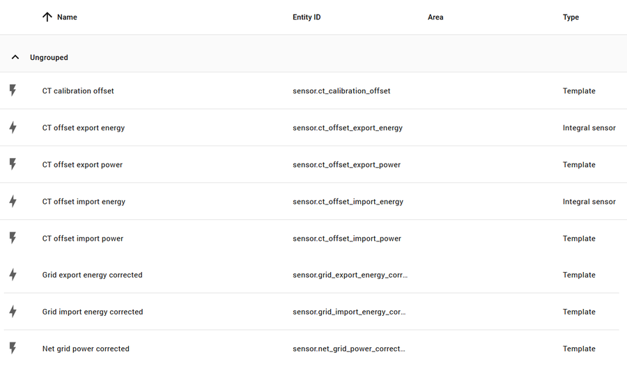
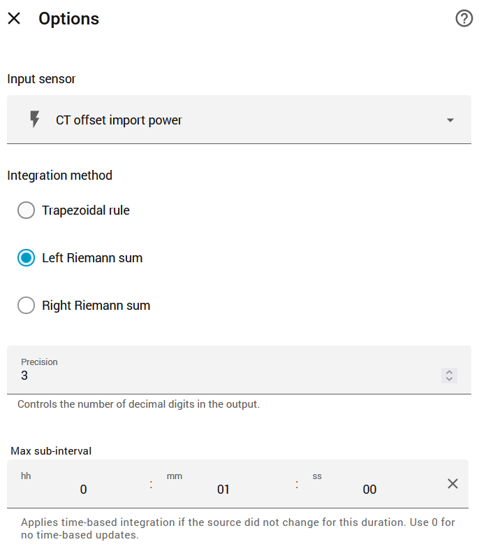

# Calibrating the meter against your billing meter

This guide is optional. The meter is already accurate enough for live dashboards. Calibrate if
you want its energy figures to match your electricity bill as closely as possible, for example to
work out costs from it.

## What to expect

On the meter this kit was developed on, the grid channel's signed net power read a **constant
14–15 W low** compared with the retailer's billing meter: 14 W too little import, and 14 W too
much export, at every load from 350 W to 3 kW. The scaling was exact (a slope of 1.00 against the
billing data). That's a fixed zero offset in the meter, so the correction is simply to add the
offset to net power.

In watts it's small, but it adds up to about 0.3 kWh a day, and at low overnight loads it's a 4 %
error. After correction, daily totals matched the billing data to within 0.1–0.3 %.

Your meter may have a different offset, or none. This guide measures it.

## What you need

- A grid clip (the channel on your main feed), and [recipe 1](RECIPES.md#1-net-grid-power)
  (net grid power) set up.
- **Three or more days of interval data from your billing meter**, hourly if possible
  (30-minute data also works): energy imported and exported in each interval. Retailers and
  distributors usually offer this as a download from their customer portal (in Australia,
  often as NEM12 data). If your retailer has a Home Assistant integration that records hourly
  statistics, its Energy dashboard download works too.
- Python 3 on any computer, to run `tools/calibrate.py` (it only uses the standard library).
  The Terminal & SSH add-on in Home Assistant has it.

## Step 1: export the meter's counters

In Home Assistant, open **History**, add the grid channel's two raw counters and its power
sensor:

- `sensor.5_channel_energy_meter_channel_1_energy_consumed` (import)
- `sensor.5_channel_energy_meter_channel_1_energy_produced` (export)
- `sensor.5_channel_energy_meter_channel_1_power` (used to skip hours with gaps)

Set the date range to cover your billing days, plus **about an hour either side**, then
⋮ > **Download data**. Save it as `history.csv`.

Use the **raw** counters, never corrected ones. Calibrating against already-corrected figures
would feed the correction back into itself.

## Step 2: prepare the billing data

Make a CSV called `billing.csv` with these columns:

```csv
start,import_kwh,export_kwh
2026-10-10T00:00:00+11:00,0.414,0.000
2026-10-10T01:00:00+11:00,0.360,0.000
```

- `start` is the start of each interval, **with its time zone** (here +11:00).
- For 30-minute data, add an `end` column with each interval's end time.
- Use the same days as your history export.

## Step 3: run the script

```bash
python3 calibrate.py history.csv billing.csv
```

If your meter's entity IDs differ from the defaults, add `--import-entity`, `--export-entity`
and `--power-entity` with your IDs. Add `--hours` to see every interval.

The output looks like this (from the development meter, 5–10 October 2026):

```text
Usable intervals: 114 (skipped 6: outside the history or with reading gaps)
Net gap, all hours:    median   14.8 W   mean   13.0 W
Import-only hours (67): median gap   14.0 W; fit: bill = 14.5 W + 0.9979 x CT
Export-only hours (13): median   16.1 W (CT export minus bill export)

Suggested offset: 15 W (add to net grid power; positive means the CT reads too little import / too much export)
```

**What it does:** for each interval, it reads the counters at the exact interval boundaries by
interpolating between the readings either side, compares the net energy (import minus export)
with the billing meter's, and converts the difference to watts. It skips intervals with gaps in
the readings. The **median** across all intervals is the suggested offset, so an occasional odd
hour (for example during rapid switching between import and export on a cloudy day) doesn't
move it.

**Reading the result:**

- **Import and export gaps of about the same size, in opposite directions** (as above): a net
  offset. This guide's correction is the right one.
- **A slope noticeably different from 1** (the script warns above 1 %): the meter also has a
  scaling error, which an offset alone won't fix. Check the clip is fully closed and sits on the
  right conductor before anything else.
- **A median within a few watts of 0:** no calibration needed.

## Step 4: create the corrected sensors

Eight helpers, created in order (Settings > Devices & services > Helpers > Create helper). The
corrected sensors sit **alongside** the raw ones, which stay untouched.

The corrected energy counters are built as **raw counter ± a small adjustment**, not as an
integral of corrected power. The raw counters keep counting through Home Assistant outages, and
the adjustment is only the offset itself, so an outage costs at most the offset (for example
15 Wh) per hour of downtime. The adjustment also handles the boundary correctly: when the meter
reads a small export of less than the offset, the house is really importing a little, so that
slice moves from export to import.



### 1. CT calibration offset

**Template sensor.** Name **CT calibration offset** · Unit **W** · Device class **Power** ·
State class **Measurement**

```jinja
{# Edit this: your measured offset in watts #}

{# Optional: a sensor that measures the offset continuously (leave '' if none) #}

{# No changes needed below #}
{{ states(external) | float(measured) if external and has_value(external) else measured }}
```

All the corrected sensors read this one value, so you change the offset in one place. The
`external` input is for an integration that measures the offset itself from your billing data;
until it has a value, the measured figure is used.

### 2. Net grid power corrected

**Template sensor.** Name **Net grid power corrected** · Unit **W** · Device class **Power** ·
State class **Measurement**

```jinja


{{ (states(net) | float(0) + states(off) | float(0)) | round(0) if has_value(net) else none }}
```

### 3. CT offset import power

**Template sensor.** Name **CT offset import power** · Unit **W** · Device class **Power** ·
State class **Measurement**

```jinja



{{ ([n + o, 0] | max - [n, 0] | max) | round(1) if has_value(net) else 0 }}
```

### 4. CT offset export power

**Template sensor.** Name **CT offset export power** · Unit **W** · Device class **Power** ·
State class **Measurement**

```jinja



{{ ([-n, 0] | max - [-n - o, 0] | max) | round(1) if has_value(net) else 0 }}
```

Both are 0 W while net grid power is unavailable, so no correction builds up without data.

### 5 and 6. CT offset import energy and CT offset export energy

**Integral sensor** helpers, one for each of the two sensors above. Use exactly these names:
steps 7 and 8 refer to them by entity ID.

| Setting | Value |
|---|---|
| Name | `CT offset import energy` / `CT offset export energy` |
| Input sensor | CT offset import power / CT offset export power |
| Integration method | Left |
| Precision | 3 |
| Metric prefix | k (kilo) |
| Time unit | Hours |
| Max sub-interval | 1 minute |

The **max sub-interval** matters: the offset often stays at the same value for hours, and
without it the integral only updates when the value changes.



### 7. Grid import energy corrected

**Template sensor.** Name **Grid import energy corrected** · Unit **kWh** · Device class
**Energy** · State class **Total**

```jinja


{{ (states(raw) | float(0) + states(adj) | float(0)) | round(3) if has_value(raw) else none }}
```

### 8. Grid export energy corrected

**Template sensor.** Name **Grid export energy corrected** · Unit **kWh** · Device class
**Energy** · State class **Total**

```jinja


{{ (states(raw) | float(0) - states(adj) | float(0)) | round(3) if has_value(raw) else none }}
```

State class **Total** rather than *Total increasing*: the raw counter moves in 0.01 kWh steps
while the adjustment grows smoothly, so the corrected export can dip by a few watt-hours between
steps, which *Total increasing* would treat as a meter reset.

Afterwards, hide the four internal helpers (3–6): entity settings > **Visible** off.

**Check the entity IDs** once they're created (Settings > Entities). If you attached a helper to
a device, Home Assistant may have added the device's name to its ID; rename it to the ID shown
here, or update the templates that refer to it.

## Step 5: use them

- **Energy dashboard, live power:** edit your grid connection and set its **Power measurement**
  to **Net grid power corrected** (step 7 of the README). Leave its energy statistics on your
  billing data, if you have them there.
- **House consumption (recipe 4):** change `net` to `sensor.net_grid_power_corrected`. Unmetered
  load (recipe 5) and the cards follow automatically.
- **Grid tiles on the cards:** change `sensor.net_grid_power` to
  `sensor.net_grid_power_corrected`.
- **Grid import and export power (recipes 2 and 3)**, if you use them: the same change.
- **Costs and reports:** use the corrected energy sensors.
- **Calibration:** always the raw counters (step 1).

The correction applies from the moment the sensors are created. It doesn't change history.

## Step 6: check it

After a full day, compare the corrected energy with your billing data for the same day, or run
the script again with the corrected sensors as `--import-entity` and `--export-entity` and the
offset should come out close to 0 W. On the development meter, the first full day gave:

| | Billing | Raw | Corrected |
|---|---|---|---|
| Import, import-only hours | 11.087 kWh | 10.885 kWh | 11.107 kWh |
| Median hourly gap, import-only hours | – | 14.1 W | 0.4 W |

Repeat the measurement every few months, or after moving a clip.

## Limitations

- **Counter step:** the meter's counters move in 0.01 kWh steps, so a single hour is only good to
  about ±0.01 kWh. The median over days is far more precise.
- **Cloudy days:** in hours with rapid switching between import and export, the CT and the
  billing meter can split the flow between directions differently, and occasionally the net
  disagrees too (one hour on the development meter was out by 0.32 kWh). The median ignores
  such hours, but they show up in hourly comparisons.
- **Circuits aren't corrected:** the offset is measured on the grid channel, where there's a
  billing meter to compare against. Other channels have no reference.
- **Outages:** the corrected sensors lose at most the offset per hour of Home Assistant
  downtime; the raw counters lose nothing.
