# Ourtop ATMS100115 5-channel Wi-Fi energy meter for Home Assistant

> **Version 1.0.0.** In daily use since October 2026, clean-install tested, and calibrated
> against billing data. Feedback and issue reports are welcome.

A setup kit for the Ourtop **ATMS100115** CT clip energy meter (a Tuya Wi-Fi
device) in Home Assistant, fully local through
[Tuya Local](https://github.com/make-all/tuya-local). No cloud connection is
needed once the meter is set up.

It gives you per-channel power, current and energy, the meter's own totals and
supply voltage, live readings at an interval you choose (1 minute day to day,
down to 15 seconds when you need detail), automatic recovery if readings stop,
and a dashboard card to control and watch it all.

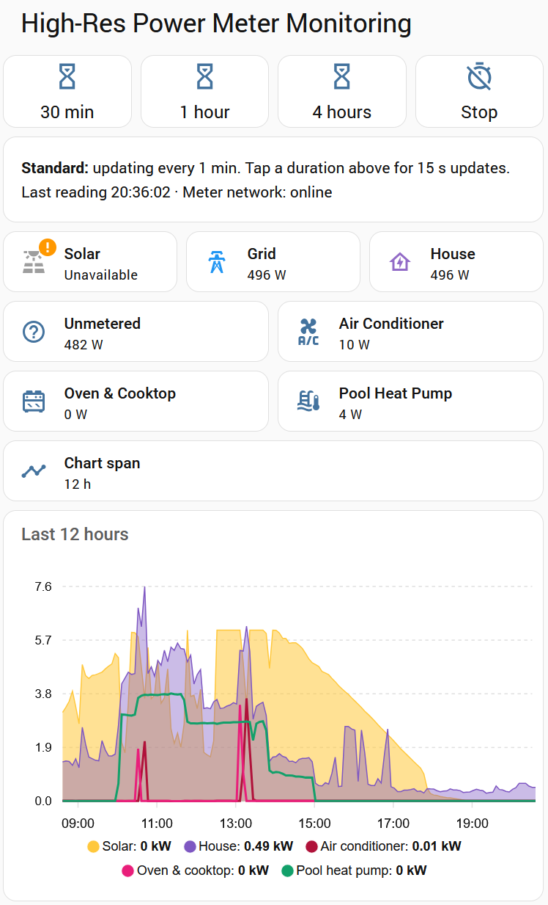

*The ApexCharts version of the card in the evening, with a 12-hour view of
the day: solar (yellow) and house consumption (purple) as overlapping
areas, and the air conditioner, oven and pool heat pump circuits as lines.
The solar tile reads "Unavailable" because the inverter switches off after
dark.*

> **Before you start: you need the meter's local key.** Like every local Tuya
> integration, Tuya Local needs the meter's device ID and **local key** (a
> secret that the meter only shares with Tuya's cloud). You have to obtain
> these yourself before you can add the meter, usually through a free Tuya
> developer account or a tool such as `tinytuya`. Tuya Local's documentation
> explains the options. Allow some time for this if you haven't done it before.

## Is this my meter?

It's a DIN-rail meter with five CT clip inputs (C1–C5), labelled on the
front **Ourtop Wifi Smart Meter ATMS100115**, 100–240 VAC 50–60 Hz,
0–100 A, with a Tuya logo and a "Touch 5s to Connect" button. The side
label reads *WiFi Smart Meter: Bidirectional Metering, Single Phase, 5 Loads
Metering*. Sellers often list it as a generic "Smart WiFi Energy Meter".
Tuya's cloud lists it as **WiFi Smart Meter 5 CT**, model `ATMS1001315`
(slightly different from the label), product ID `eedoqrlzlhrgkqnu`. That
product ID is what Tuya Local uses to recognise it.

The three-phase model, **ATMS100133**, is a different device that Tuya Local
already supports. It may have the same refresh behaviour, in which case the
blueprints here could help with it too, but that is untested.

## What's in the kit

| File | What it is |
|---|---|
| `devices/ourtop_atms100115_energymeter.yaml` | Tuya Local device config: defines all the meter's entities |
| `blueprints/tuya_meter_refresh.yaml` | Automation blueprint: keeps readings fresh, with an optional high-res mode |
| `blueprints/tuya_meter_stale_recovery.yaml` | Automation blueprint: reloads the meter if readings stop, and alerts you if that doesn't help |
| `dashboard/energy_meter_card.yaml` | Dashboard card: high-res controls, status, live power and history |
| `dashboard/energy_now_summary_card.yaml` | Optional compact summary for a main dashboard, opening the Energy now view (needs ApexCharts) |
| `dashboard/energy_now_daily_card.yaml` | Optional daily energy bar chart by channel (built-in card) |
| `dashboard/energy_meter_card_apexcharts.yaml` | Optional card for solar users: translucent solar and house areas with circuit lines (needs the ApexCharts card from HACS) |
| [`RECIPES.md`](RECIPES.md) | Template recipes for net grid power, import/export, house consumption and unmetered load |
| [`CALIBRATION.md`](CALIBRATION.md) and `tools/calibrate.py` | Optional: measure the meter's offset against your billing data, and corrected sensors that apply it |

## Why the meter needs a refresh automation

This meter doesn't behave like most Tuya energy devices:

- **It only measures when asked.** It sends a fresh set of readings when its
  refresh datapoint (DP 35) is set to `online`, which is what the vendor app
  does while it's open. Each request gives exactly one report, delivered over
  about 3–4 seconds.
- **Otherwise it reports every 15 minutes** on its own.
- **Polling doesn't help.** Tuya Local's regular status poll returns the
  meter's last stored snapshot, and the per-channel readings aren't included
  at all. The meter also ignores Tuya's "update datapoints" request.

So something has to write DP 35 regularly, and that is the refresh blueprint's
job.

## Requirements

- Home Assistant 2024.10 or later
- [Tuya Local](https://github.com/make-all/tuya-local), installed through HACS
- The meter's device ID and local key (see *Before you start* above)
- A way to add a file to your Home Assistant `/config` folder, for example
  the **File editor** add-on (easiest), **Studio Code Server**, a **Samba
  share**, or the **Terminal & SSH** add-on

> **Safety:** the meter and its CT clips are installed in your switchboard.
> In many countries, including Australia and New Zealand, that is licensed
> electrical work. Use a licensed electrician.

## Installation

### 1. Device config

Until this config is included in Tuya Local itself:

1. Create the file
   `/config/custom_components/tuya_local/devices/ourtop_atms100115_energymeter.yaml`
   and paste in the contents of
   [`devices/ourtop_atms100115_energymeter.yaml`](devices/ourtop_atms100115_energymeter.yaml)
   (open it on GitHub and use the **Copy raw file** button). With the File
   editor add-on: browse to the folder, create a new file with that name,
   paste, save.
2. Restart Home Assistant.
3. Go to Settings > Devices & services > **Tuya Local** > **Add device**.

   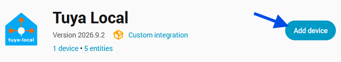

4. Choose **Manually provide device connection information**.

   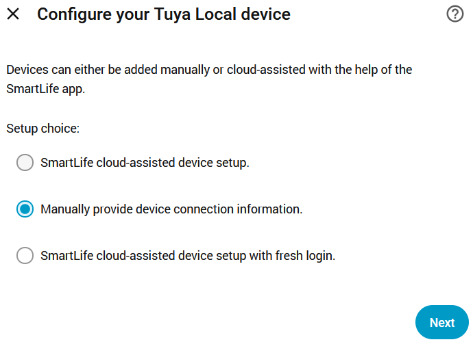

5. Enter the device ID, the meter's IP address or hostname, and the local
   key. Protocol **3.5** works for this meter (or try *auto*). Leave **Poll
   only** unticked.

   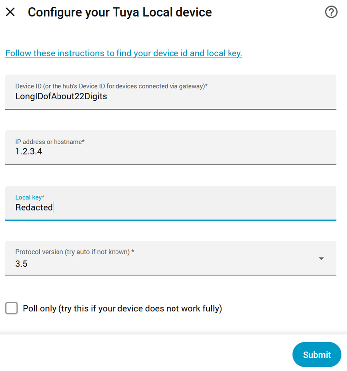

6. Choose **Ourtop ATMS100115** as the device type. If it isn't offered,
   the file from step 1 isn't in place: check its name and location, then
   restart.

   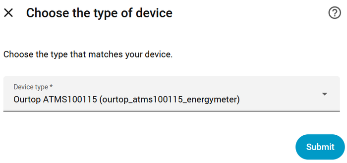

7. The meter appears as **5-channel energy meter**, with 33 entities. The
   channel sensors stay `unknown` until the refresh automation (step 3) is
   running.

   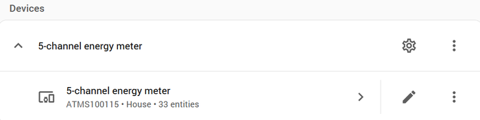

Tuya Local updates replace its `devices` folder, so copy the file back after
each update until it's included upstream. Keep a copy outside
`custom_components`.

### 2. Timer helper (optional, for high-res mode)

Settings > Devices & services > Helpers > Create helper > **Timer**:

- Name: **Energy meter high-res** (the dashboard card expects
  `timer.energy_meter_high_res`)
- Duration: anything, for example 1 hour (the card's buttons set their own)
- Tick **Restore**, so a running high-res period survives a restart

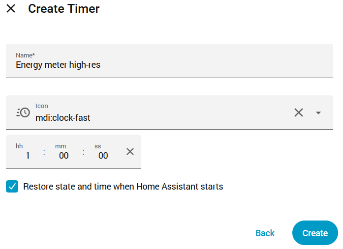

### 3. Refresh blueprint

> **About the import buttons:** they go through my.home-assistant.io, which
> opens the Home Assistant address your browser saved there. If it opens the
> wrong address (for example `http` instead of `https`), correct it on the
> page that appears and it will remember. Or import manually: Settings >
> Automations & scenes > Blueprints > **Import blueprint**, and paste the
> blueprint's GitHub address (listed under each button).

[](https://my.home-assistant.io/redirect/blueprint_import/?blueprint_url=https%3A%2F%2Fgithub.com%2Fr5e%2Fha-ourtop-atms100115-energy-meter%2Fblob%2Fmain%2Fblueprints%2Ftuya_meter_refresh.yaml)

Address for manual import:
`https://github.com/r5e/ha-ourtop-atms100115-energy-meter/blob/main/blueprints/tuya_meter_refresh.yaml`

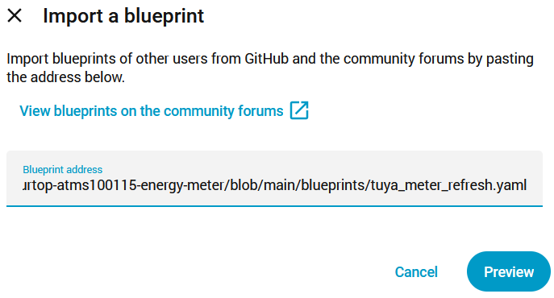
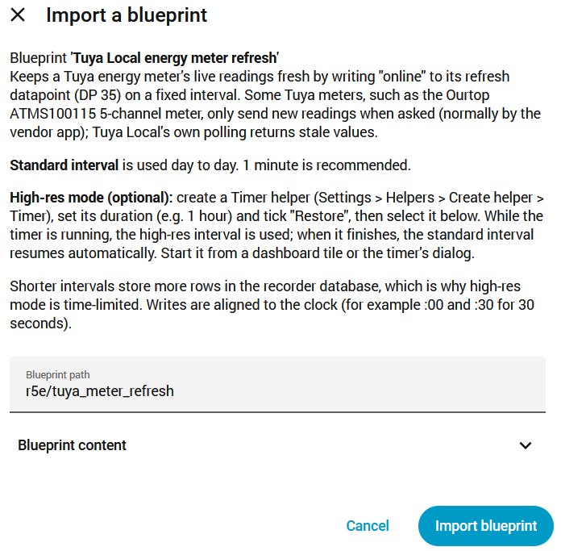

Create an automation from it:

- **Refresh entity:** the meter's Refresh select
- **Standard interval:** 1 minute is recommended
- **High-res timer:** the timer from step 2 (or leave empty)
- **High-res interval:** 15 or 30 seconds

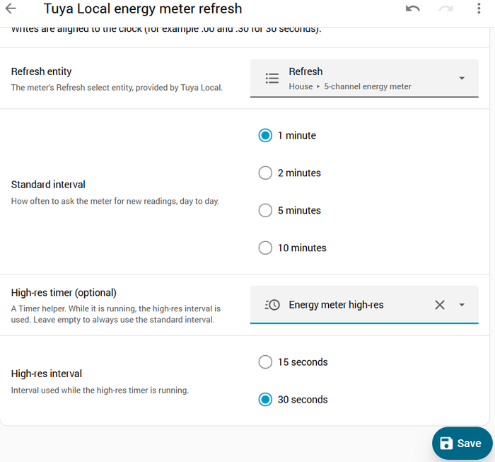

Save it, then **check that it's enabled** (the toggle in Settings >
Automations & scenes). Within a minute, the channel sensors should show
readings.

High-res mode runs **only while the timer is counting down**. Start it from
the dashboard card's buttons (step 5) or the timer itself. When the timer
finishes, the standard interval resumes automatically.

### 4. Recovery blueprint (recommended)

[](https://my.home-assistant.io/redirect/blueprint_import/?blueprint_url=https%3A%2F%2Fgithub.com%2Fr5e%2Fha-ourtop-atms100115-energy-meter%2Fblob%2Fmain%2Fblueprints%2Ftuya_meter_stale_recovery.yaml)

Address for manual import:
`https://github.com/r5e/ha-ourtop-atms100115-energy-meter/blob/main/blueprints/tuya_meter_stale_recovery.yaml`

Create an automation from it:

- **Sensor to watch:** the meter's **Supply voltage** sensor
- **Timings:** the defaults (5, 2 and 5 minutes) suit a 1- or 2-minute
  standard interval. For longer intervals, set *stale after* to about
  2.5 times the standard interval.

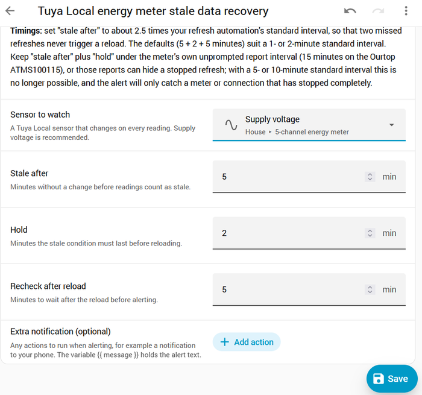

Save it, and check that both automations are enabled:

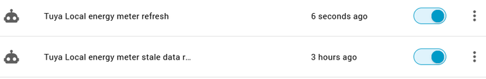

If readings stop, it reloads the meter's Tuya Local entry. If that doesn't
bring them back, it raises a notification (plus any action you add, such as a
phone notification), which clears itself once readings return.

### 5. Dashboard card

Edit a dashboard > Add card > **Manual**, clear the editor, and paste
`dashboard/energy_meter_card.yaml`. The comment at the top lists the entity
IDs it uses. They match a fresh install with the default names; if yours
differ, adjust them before saving:

- **Meter entities:** one find-and-replace does them all. Replace
  `5_channel_energy_meter` with the prefix your meter's entity IDs actually
  use (Settings > Entities, search for the meter).
- **Timer:** `timer.energy_meter_high_res` if you named it as in step 2.
- **Ping sensor:** optional; the status line hides it if the entity doesn't
  exist.
- **Net grid power:** `sensor.net_grid_power` from the recipes (step 6).

"Entity not found" on a tile, or "No state history found" on the graph,
means an ID in the card doesn't match.

**With solar: the ApexCharts version.** `dashboard/energy_meter_card_apexcharts.yaml`
draws solar and house consumption as translucent overlapping areas, with
the circuits as lines on top, so you can see at a glance how much of the
house's use the sun is covering. It needs the **ApexCharts card** (HACS >
Frontend > search "ApexCharts"), recipe 4, and your solar power sensor in
place of `sensor.solar_power`. Its **Chart span** tile switches the chart
between 1, 4, 12 and 24 hours with each tap; it needs a Dropdown helper
(Settings > Devices & services > Helpers > Create helper > **Dropdown**)
named **Energy meter chart span**, with the options `1 h`, `4 h`, `12 h`
and `24 h`, in that order.

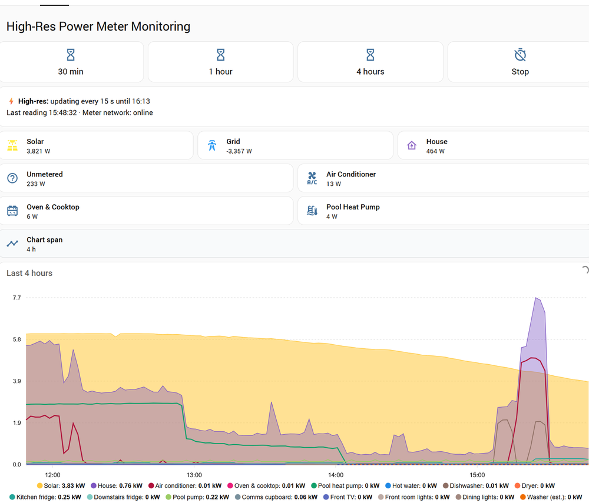
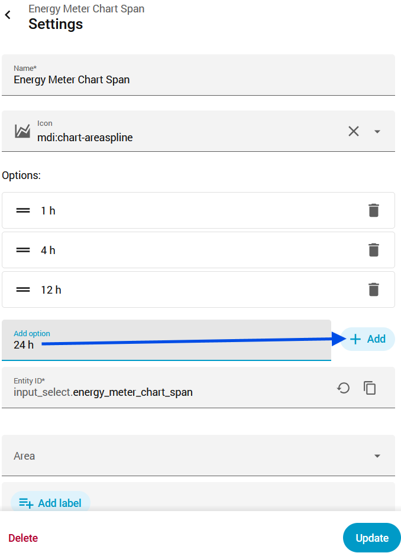

The card has the high-res buttons (30 minutes, 1 hour, 4 hours, stop), the
current mode and last reading time, live power tiles, and a history graph
whose time range follows the high-res period.

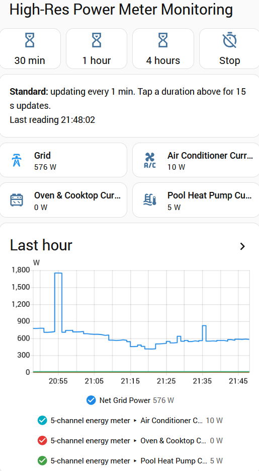

### 6. Derived sensors

See [RECIPES.md](RECIPES.md) for net grid power, import and export power,
house consumption and unmetered load. Each one is a copy-and-paste Template
helper; no YAML files needed.

### 7. Energy dashboard (optional)

**Live power on the Now tab.** In Settings > Dashboards > Energy, edit your
grid connection (its pencil icon) and scroll to the bottom of the dialog.
Under **Type of power measurement**, choose **Standard**, then select
**Net grid power** (recipe 1) as the **Power measurement**. With a solar
power sensor alongside it, the **Now** tab shows live grid, solar and house
figures at the refresh interval, and its consumption line becomes real
house consumption. Details are in [RECIPES.md](RECIPES.md#live-power-on-the-energy-dashboards-now-tab).

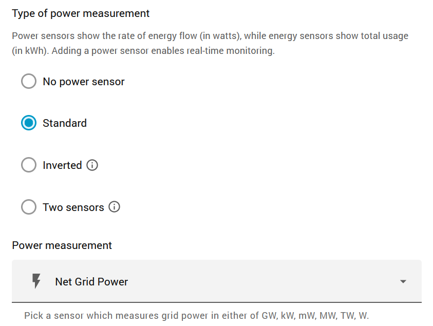
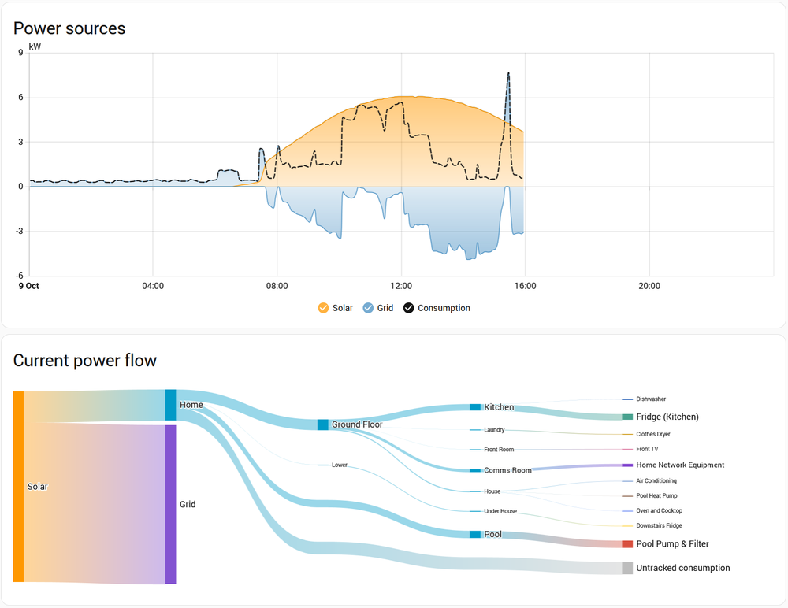

**Circuits as individual devices.** Add each clipped circuit under
**Individual electrical devices**, with its *energy consumed* sensor and its
*power* sensor. Some things to know:

- Devices are a **breakdown** of your consumption, not an extra source, so
  adding their energy doesn't double-count your grid import.
- They appear in the Now tab's **power flow**, not in the power sources
  graph, which only shows where power comes from.
- **Don't** add the grid channel, house consumption or unmetered load as a
  device: they are totals, and would count the circuits twice.
- Home Assistant's own **untracked consumption** is the same idea as
  recipe 5's unmetered load.
- If one device sits inside another (for example a smart plug on a clipped
  circuit), set the plug's **Upstream device** to the circuit, so its
  energy isn't counted twice.

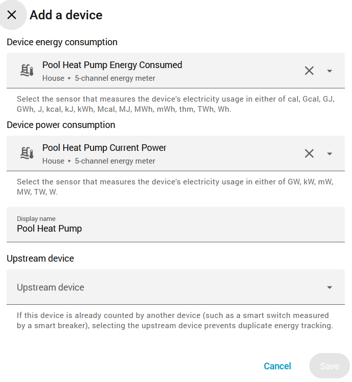

## Calibration (optional)

Compared with the retailer's billing meter, the development meter's grid channel read about
10–15 W low on net power on average (varying from day to day), with exact scaling. [CALIBRATION.md](CALIBRATION.md) shows how to
measure your own meter's offset from your billing data (with `tools/calibrate.py`), and how to
build corrected sensors that apply it alongside the raw ones. After correction, totals over
11 days matched the billing data to within about 0.5 %.

## Adding solar, a battery or other sources

The meter only measures what its clips are on, but the card and recipes
work with any power sensor in Home Assistant, so you can bring in solar,
a battery, or plug-metered devices from other integrations.

- **House consumption:** recipe 4 combines net grid power with a solar
  power sensor, and optionally a battery, to give total household use.
- **Card tiles:** add a tile for any power sensor, for example:

  ```yaml
  - type: tile
    entity: sensor.your_solar_power
    name: Solar
    color: yellow
    icon: mdi:solar-power-variant
  ```

- **Card graphs:** each time range has two graphs, grid on top and circuits
  below. Add the sensor to the **top** graph of each range, with a fixed
  colour so it is easy to recognise:

  ```yaml
  - entity: sensor.your_solar_power
    name: Solar
    color: "#FBC02D"
  ```

  The card gives its own lines fixed colours (grid blue, circuits cyan, red
  and green), so new lines don't clash with them. Add the same entry to the
  top graph of all three ranges (30 minutes, 1 hour, 4 hours).
- **Energy dashboard:** add solar and battery as their own sources in the
  Energy settings, with their power sensors, alongside net grid power
  (step 7).

Check units: many inverters report kW where the meter reports W. Graphs
with mixed units are split into separate charts.

## Adding appliances to the chart

Smart plugs and other devices with their own power sensor can go on the
same chart as the meter's circuits. Thin lines in softer colours keep the
main picture readable, and tapping a name in the chart's legend hides or
shows its line (all lines reappear when the page reloads).

Add an entry like this to the `series:` list of each chart (the ApexCharts
card has one chart per span):

```yaml
- entity: sensor.dishwasher_plug_power
  name: Dishwasher
  type: line
  color: "#8D6E63"
  stroke_width: 1.5
  curve: straight
  transform: return Number(x) / 1000;
  unit: kW
  float_precision: 2
  group_by:
    func: avg
    duration: 30s
```

Use the same `duration` as the other series in that chart. Leave out
totals (grid, house), duplicates (for example PoE ports already inside a
plug-metered cupboard) and devices on a clipped circuit, which the circuit
already shows. Devices that report energy but not power can be added with
recipe 6; draw them dashed (`stroke_dash: 4`, and no `transform`, as they
are already in kW) so they read as estimates.

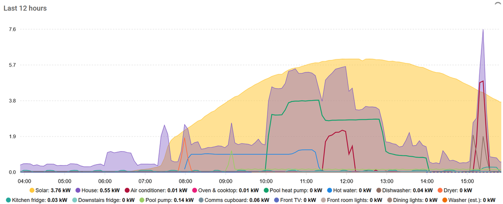

## Energy now view (optional)

Once the card has grown, it works well as its own dashboard page, with a
compact summary on your main view that opens it:

1. Edit your dashboard, add a view titled **Energy now** with the URL
   **`energy-now`**, and put the ApexCharts card on it, followed by
   `dashboard/energy_now_daily_card.yaml` (daily energy by channel for the
   last week, a built-in card). A **Panel** view gives the chart the full
   page width but holds only one card: in that case, add the daily chart
   as the last item in the ApexCharts card's `cards:` list instead.
2. Put `dashboard/energy_now_summary_card.yaml` on your main view: Solar,
   Grid and House tiles that open the Energy now view when tapped, and a
   small 6-hour chart. Change `/lovelace/energy-now` in its three tiles to
   your dashboard's path, for example `/dashboard-home/energy-now`.

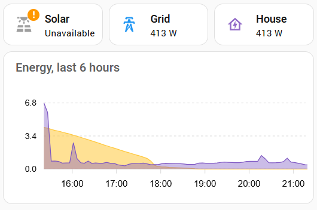
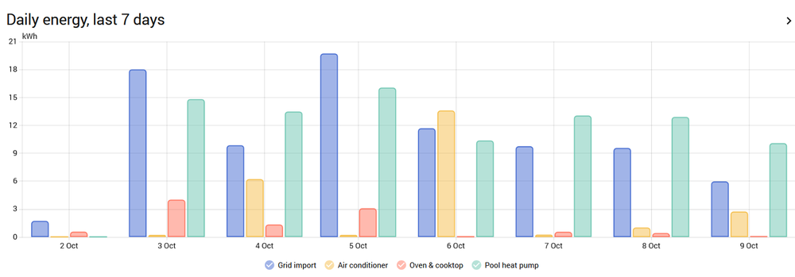

**Reading the daily chart:** grid import is only the energy bought from
the grid, not what the house used. With solar, a circuit such as a pool
heat pump can use more in a day than the house imports, because it runs on
solar. For bars that add up (solar + import − export = house use), add your
solar inverter's total energy sensor and the grid channel's *energy
produced* (export) to the chart:

```yaml
  - entity: sensor.your_solar_total_energy
    name: Solar generated
  - entity: sensor.5_channel_energy_meter_channel_1_energy_produced
    name: Grid export
```

The chart includes today (part-way through), so `days_to_show: 7` gives
eight bars; use 6 for exactly seven.

## Entities

| Entity | Notes |
|---|---|
| Channel N power (W) | **Unsigned:** the size of the flow, in either direction. Check the channel's export sensor for direction |
| Channel N current (A) | Diagnostic |
| Channel N export | On while the channel's power flows outwards (for example solar export on a grid clip) |
| Channel N energy consumed / produced (kWh) | Per-channel counters, split by direction |
| Supply voltage (V) | Measured from the meter's own mains supply, whatever is clipped where |
| Energy consumed / produced, Energy, Power, Reactive power, Power factor | The meter's own totals across all channels |
| Refresh | Used by the refresh blueprint; always shows `online` |

**Export sensors** are only meaningful on channels that can actually carry
power outwards, such as a grid clip with solar, or a solar or battery clip.
On other channels the direction flag is random whenever the current is close
to zero, which fills the logbook with on/off flips. Disable the export sensor
for any channel that can never export (Settings > Entities > the entity >
Enabled off). Don't disable one that a recipe uses.

**A grid clip doesn't show house consumption.** It measures the flow at
the grid connection. With solar, switching on a big appliance often makes
the grid channel's power go *down*: the appliance soaks up solar that was
being exported. Use net grid power (recipe 1) for the grid flow, and house
consumption (recipe 4) for what the house is using.

**The meter's totals** add up all channels. That's correct when every clip is
on a separate circuit, but if one clip is on the whole-house feed and others
on circuits inside the house, those circuits are counted twice. In that
layout, hide the totals and use the recipes instead.

## Example layouts

- **Whole house plus circuits:** grid feed on one channel, individual circuits
  (air conditioner, oven, pool, …) on the others. Use recipe 1 for the grid
  channel and recipe 5 for unmetered load. This is the layout the kit was
  developed on.
- **Circuits only:** no grid clip. Use the channel power sensors directly;
  the meter's totals are a valid sum.
- **Solar:** a clip on the grid feed shows import and export through its
  export sensor. A clip on the inverter output can be treated like any other
  channel.
- **Three-phase:** not supported by this single-phase meter. See the
  ATMS100133 above.

## What's been tested

On a single-phase supply with a whole-house clip and three circuit clips:

- **1-minute standard interval:** in continuous use for three weeks and more. Occasional
  short Wi-Fi dropouts (about one a fortnight) were caught and fixed automatically by the
  recovery blueprint.
- **30-second interval:** run overnight with no missed readings.
- **15-second high-res periods:** working over short test periods.
- **Recovery blueprint:** tested end to end (stale detection, reload, alert,
  automatic clearing).

Database growth at a 30-second interval was roughly 25 MB a day for the whole
Home Assistant database. That's a rough figure, but it's why high-res mode is
time-limited rather than permanent.

## Limitations

- **One report per refresh.** Shorter intervals mean more writes and more
  network traffic. Each report takes about 3–4 seconds to arrive, so very
  short intervals leave little margin.
- **Short gaps after a reload or restart.** The channel sensors show
  `unknown` until the next refresh.
- **No Wi-Fi signal reporting.** The meter doesn't report its own signal
  strength. The optional Ping integration on its hostname gives a useful
  substitute; the card shows its status if the sensor exists.
- **Single-phase only** (see above for the three-phase model).

## Troubleshooting

- **Channel sensors stay `unknown`:** check the refresh automation is
  **enabled** and its Refresh entity is selected. A status poll alone never
  fills them in.
- **Re-adding a meter you removed earlier:** Home Assistant remembers
  removed entities, and restores their old entity IDs, names and
  enabled/disabled settings when the same meter is added again. Your entity
  IDs may then differ from the defaults used in the card and recipes.
- **"receive loop has terminated" in the log:** Tuya Local logs this
  whenever the connection to the meter closes, including every reload. If it
  appears without a reload, the connection genuinely dropped.
- **"Energy meter not updating" notification:** check the refresh automation
  first, then the meter's Wi-Fi. A power cycle at the meter's isolator is the
  last resort.

## Maintenance note

Tuya Local builds each entity's unique ID from its **name** in the device
config. Renaming an entity in the config creates a new entity and orphans the
old one, with its history. Entity names in `ourtop_atms100115_energymeter.yaml` are
therefore fixed once published. Rename entities in the Home Assistant UI
instead, which is always safe.

## Credits

Built on [Tuya Local](https://github.com/make-all/tuya-local) by make-all.

## Licence

MIT. See [LICENSE](LICENSE).
