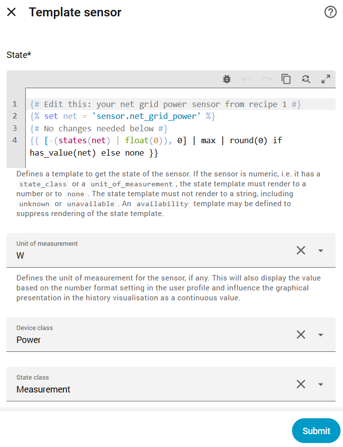
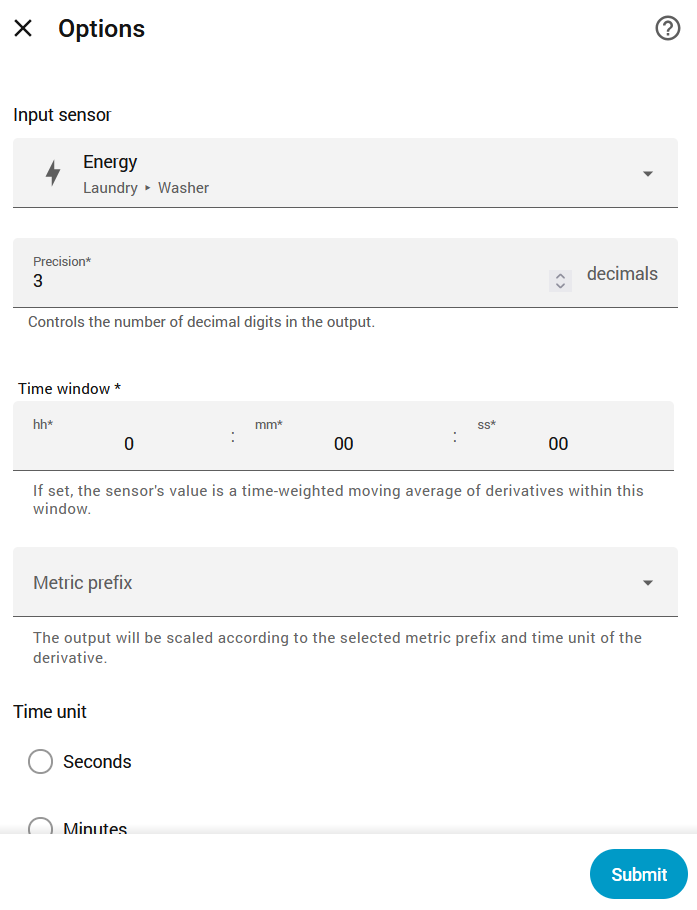
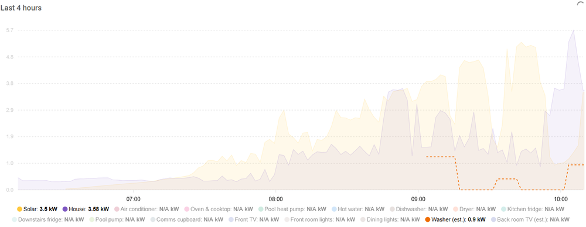

# Derived sensor recipes

The meter reports each channel as an unsigned power reading plus an export
flag. These recipes turn those into the sensors most dashboards need: signed
grid power, import and export power, house consumption and unmetered load.

Each recipe is a **Template sensor helper**, created in the UI with no YAML:

1. Settings > Devices & services > Helpers > **Create helper** > **Template** > **Template sensor**.
2. Paste the recipe into **State template**.
3. Edit only the lines at the top, marked *Edit these*. Everything below
   *No changes needed below* works as it is.
4. Set **Name**, **Unit**, **Device class** and **State class** as listed with the recipe.
   Using the suggested names gives the entity IDs the later recipes and the
   dashboard card expect (for example `sensor.net_grid_power`).

The preview under the template shows the result straight away, so you can
check it before saving.



The examples use the entity IDs of a fresh install with the default device
name (`sensor.5_channel_energy_meter_...`). If your meter's IDs use a
different prefix, replace `5_channel_energy_meter` with yours. A recipe
showing **unknown** in the preview usually means an ID doesn't match.

## Which recipes do I need?

| Your layout | Recipes |
|---|---|
| Whole-house clip (grid feed) plus circuit clips | 1, 2, 3, 5 (add 4 if you have solar) |
| Whole-house clip only | 1, 2, 3 (add 4 if you have solar) |
| Circuit clips only, no grid clip | None needed: use the channel power sensors directly |

Any channel can be the grid channel. Nothing assumes channel 1.

The ATMS100115 is a single-phase meter. For a three-phase supply, Ourtop
makes a separate model (ATMS100133), which Tuya Local already supports.

## 1. Net grid power

Positive when importing from the grid, negative when exporting. Normally the
list holds just your grid channel. If your supply arrives on more than one
clipped feed, list each one and they are added together.

If any listed sensor is unavailable (for example an export sensor that has
been disabled), the result is **unknown** rather than a wrong number.

```jinja
{# Edit these: (power sensor, export sensor) for each grid channel #}

{# No changes needed below #}


  
    
  
  
  

{{ ns.total | round(0) if ns.ok else none }}
```

Name **Net grid power** · Unit **W** · Device class **Power** · State class **Measurement**

## 2. Grid import power

```jinja
{# Edit this: your net grid power sensor from recipe 1 #}

{# No changes needed below #}
{{ [states(net) | float(0), 0] | max | round(0) if has_value(net) else none }}
```

Name **Grid import power** · Unit **W** · Device class **Power** · State class **Measurement**

## 3. Grid export power

```jinja
{# Edit this: your net grid power sensor from recipe 1 #}

{# No changes needed below #}
{{ [-(states(net) | float(0)), 0] | max | round(0) if has_value(net) else none }}
```

Name **Grid export power** · Unit **W** · Device class **Power** · State class **Measurement**

## 4. House consumption (solar)

Everything the house is using: grid power plus solar generation (plus
battery discharge, if you have a battery). The solar
sensor counts as 0 W when it is unavailable, as many inverters go offline
overnight. Without solar, net grid power already *is* house consumption, so
you don't need this recipe.

```jinja
{# Edit these #}


  {# optional: signed battery power, + when discharging #}
{# No changes needed below #}

  
  {{ (states(net) | float(0) + states(solar) | float(0) + b) | round(0) }}

  {{ none }}

```

Name **House consumption** · Unit **W** · Device class **Power** · State class **Measurement**

Check your solar sensor's unit. If it reports kW, use
`states(solar) | float(0) * 1000` instead.

**Battery:** set `battery` to your battery's power sensor if it is signed
positive while discharging and negative while charging. Many inverters use
the opposite sign; in that case use `-(states(battery) | float(0))`.

## 5. Unmetered load

House consumption that isn't measured by anything else: the clipped
circuits, plus any smart plugs or other power-metered devices you list.
What's left is genuinely unidentified load, useful for finding your
always-on base load and for spotting which unmonitored appliance would be
worth a smart plug.

There are two lists:

- **`metered`:** the clipped circuits. If one is unavailable, the result is
  **unknown**.
- **`optional`:** smart plugs and other devices with their own power sensor.
  One that is unavailable counts as 0 W, so a plug dropping offline can't
  blank the result.

Only list devices that are **not** on a clipped circuit, or they will be
subtracted twice.

```jinja
{# Edit these #}



{# No changes needed below #}


  
  


  

{{ [states(house) | float(0) - ns.total, 0] | max | round(0) if ns.ok else none }}
```

Name **Unmetered load** · Unit **W** · Device class **Power** · State class **Measurement**

Small negative values are possible when readings from different devices
arrive at slightly different times, so the result is floored at 0 W.
Without solar, use your net grid power sensor as `house`. If you have no
other metered devices, leave `optional` as an empty list: `[]`.

## 6. Estimated power from an energy-only device

Some appliances (many SmartThings washers, dryers and TVs, for example)
report energy but not power. A **Derivative** helper turns the energy
sensor into an estimated power sensor for charts. It's a visual estimate,
not a measurement: it is only as fine as the energy updates (a washer that
reports 0.1 kWh every 15 minutes gives 15-minute blocks of about 0.4 kW),
and the first block of each run reads low, because the energy is spread
back to the previous update.

Settings > Devices & services > Helpers > Create helper > **Derivative
sensor**:

| Setting | Value |
|---|---|
| Name | for example `Washer power estimated` |
| Input sensor | the appliance's **energy** sensor (kWh) |
| Time window | 0 |
| Metric prefix | none |
| Time unit | Hours (kWh per hour comes out in **kW**) |

**Check the entity IDs.** If you attach a helper to a device while creating
it, Home Assistant may prefix its entity ID with the device's name (for
example `sensor.laundry_washer_washer_power_raw`). Check the real IDs in
Settings > Entities, and use them in the template below and in your card.



**Optional: drop to zero when the appliance stops.** A derivative only
recalculates when its source changes, so after a run it can hold its last
value until the next one. If the appliance has a state sensor (running,
stopped), name the derivative `... power raw` instead, and create a
Template sensor helper with the final name:

```jinja
{# Edit these #}



{# No changes needed below #}

  {{ [states(raw) | float(0), 0] | max | round(3) }}

  0

```

Name **Washer power estimated** · Unit **kW** · Device class **Power** · State class **Measurement**

The state sensor's stored values can differ from what the UI shows (for
example `run` displayed as "Running"); check its `options` attribute in
Developer Tools > States and adjust `running` to match.

**Late reports:** some devices deliver their energy late, sometimes only
after the run has finished. With the stop gating, the estimate then shows
nothing for that run, although the energy total is still correct.

Use these for charts only. For the Energy dashboard, keep using the
appliance's real energy sensor, not the estimate.



### Variant: devices that report energy per window

Some devices don't report a running total at all, only the energy used in
each reporting window (for example, a Samsung TV's 15-minute
`deltaEnergy` windows). Check the energy sensor's history: a running total
only ever climbs, while per-window energy goes up and down. For per-window
energy, skip the Derivative: power is the window's energy divided by its
length. If the sensor has `start` and `end` attributes for the window, a
Template sensor helper can work it out exactly:

```jinja
{# Edit this: the per-window energy sensor (Wh) #}

{# No changes needed below #}



  
  {{ (states(w) | float(0) / h / 1000) | round(3) if h > 0 else none }}

  {{ none }}

```

Unit **kW** · Device class **Power** · State class **Measurement**

Without `start` and `end` attributes, use the window length you see in the
history instead: for 15-minute windows in Wh,
`{{ (states(w) | float(0) * 4 / 1000) | round(3) }}`. The line lags real
time by up to a window, as each window is only reported after it ends.

## Energy dashboard

No recipes are needed for energy (kWh). The meter's own per-channel counters
already split by direction:

- **Grid consumption:** the grid channel's *energy consumed* sensor.
- **Return to grid:** the grid channel's *energy produced* sensor.
- **Individual devices:** each circuit channel's *energy consumed* sensor.

If you listed more than one feed in recipe 1, combine each direction's
counters with the built-in **Combine the state of several sensors** helper
(type *Sum*), again with no template needed.

### Live power on the Energy dashboard's **Now** tab

Home Assistant's Energy settings also accept **power** sensors, which drive
the live **Now** view. The grid's power sensor must be a single signed
sensor (positive importing, negative exporting), which is exactly recipe 1:

1. Settings > Dashboards > **Energy**, and edit your grid connection (its
   pencil icon). Leave its energy settings as they are.
2. Scroll to the bottom of the dialog. Under **Type of power measurement**,
   choose **Standard** and select **Net grid power**
   (`sensor.net_grid_power`) as the **Power measurement**. (**Two sensors**
   takes recipes 2 and 3 instead; **Inverted** is for sensors that are
   negative when importing.)
3. If your solar source has a power sensor too (most inverters do), Home
   Assistant works out live house consumption from the two.
4. Optionally, give each circuit's individual device its channel power
   sensor as well.

Live values update at the refresh blueprint's interval.
